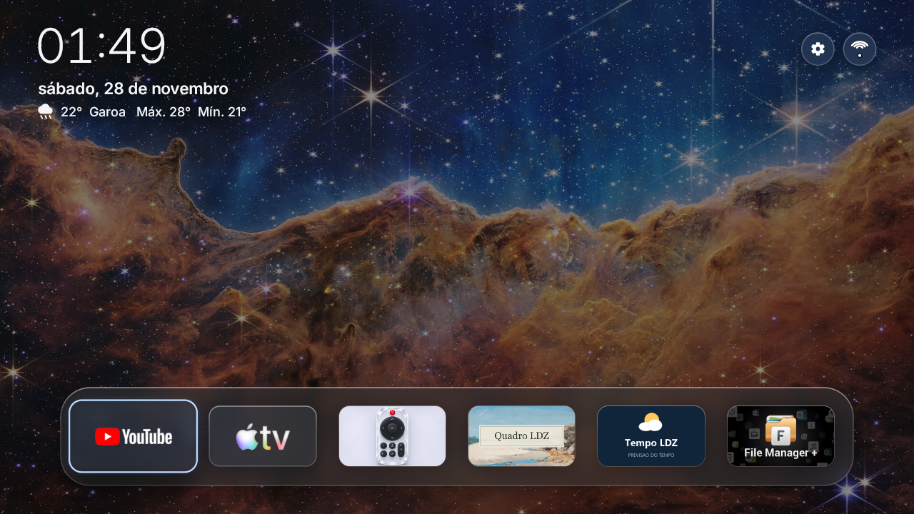
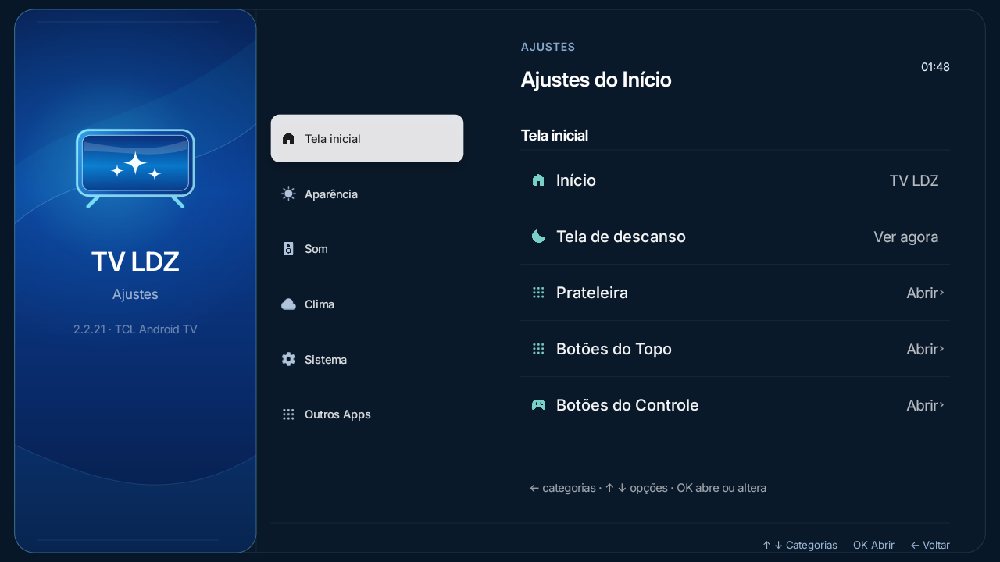
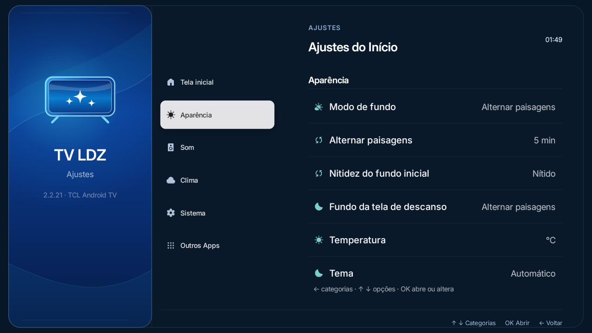
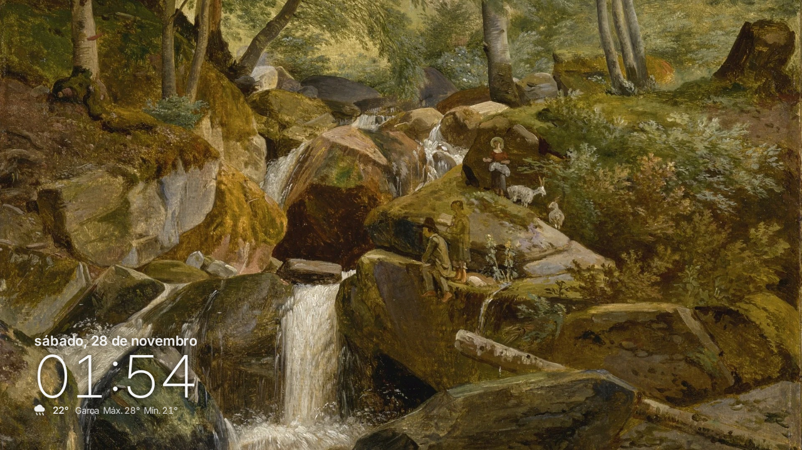
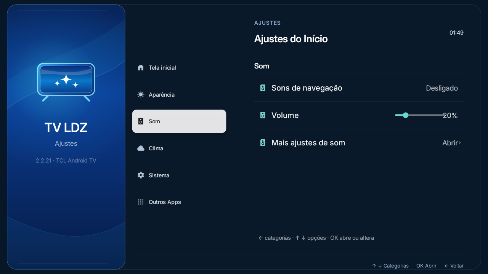
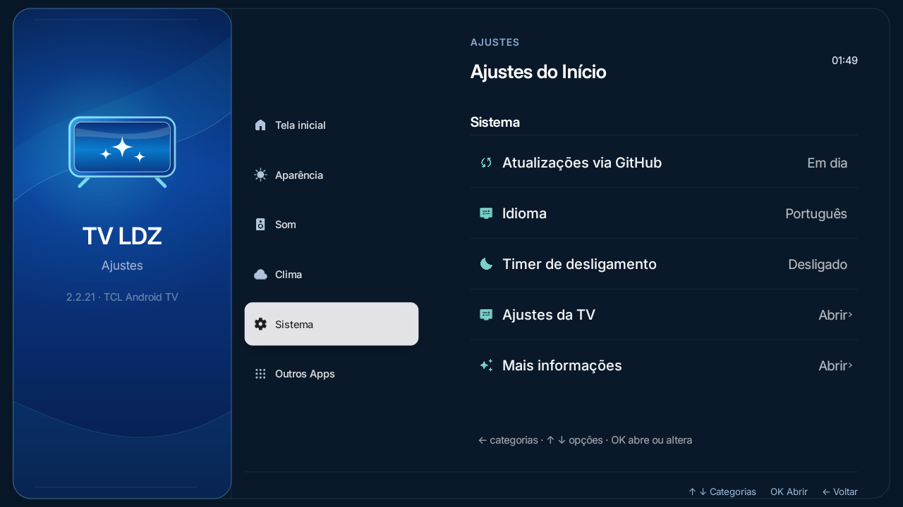
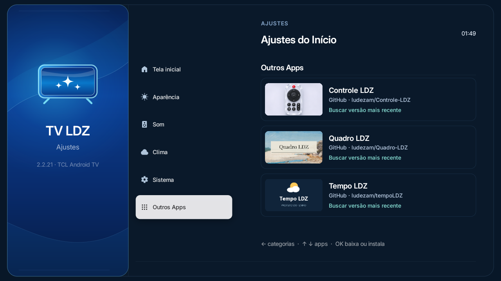
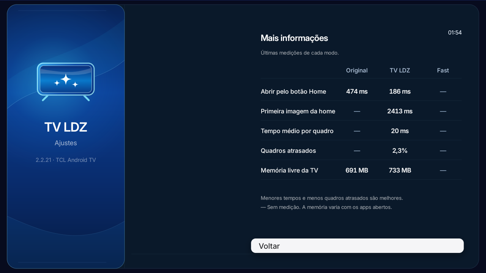

# TV LDZ

**TV LDZ** é um launcher personalizado para Google TV e Android TV, inspirado no projeto [Free My TV de simbasjungles](https://github.com/simbasjungles/free-my-tv). Esta compilação é mantida separadamente por LuDeZam e não é afiliada, patrocinada ou endossada pelos mantenedores do projeto original.

> O nome deste projeto é TV LDZ. Free My TV é o projeto original que serviu de inspiração; os créditos e a licença do código original estão preservados nesta distribuição.

## Experimente no navegador

**[Abrir o demo interativo do TV LDZ](https://ludezam.github.io/TV-LDZ/demo.html)**

Explore a tela inicial, os Ajustes por categorias, as miniaturas de fundos, a tela de descanso, a prateleira, Entradas e Atalhos. O demo mantém a tela da TV em **16:9**; no celular, vire o aparelho para a posição horizontal. Use o controle na página, toque/clique ou as teclas **setas**, **Enter** e **Esc**. Segure um app da prateleira para abrir seu menu.

As preferências são salvas apenas no navegador. Horário e data acompanham o dispositivo; clima, aplicativos e ações do Android são simulados. O demo não se conecta à TV nem instala aplicativos.

O código está em [`demo.html`](demo.html) e reutiliza as imagens e a fonte de `app/assets`. Para abrir localmente, baixe o repositório completo e abra esse arquivo.

## Capturas de tela

Capturas reais da versão **2.2.21**, feitas em 28/11/2026 em uma TV TCL com Android TV. Para explorar os menus mais recentes, abra a demonstração acima.

<table>
  <tr>
    <td align="center"><strong>Tela inicial</strong><br></td>
    <td align="center"><strong>Ajustes · Tela inicial</strong><br></td>
  </tr>
  <tr>
    <td align="center"><strong>Ajustes · Aparência</strong><br></td>
    <td align="center"><strong>Tela de descanso</strong><br></td>
  </tr>
  <tr>
    <td align="center"><strong>Ajustes · Som</strong><br></td>
    <td align="center"><strong>Ajustes · Sistema</strong><br></td>
  </tr>
  <tr>
    <td align="center"><strong>Outros Apps</strong><br></td>
    <td align="center"><strong>Mais informações</strong><br></td>
  </tr>
</table>

## Opções de tela de fundo e de descanso

Você pode escolher os fundos da **Tela inicial** e da **Tela de descanso** de forma independente. As opções incluem paisagens embutidas, fotos enviadas pelo Controle LDZ e **Clima e horário**, que usa ilustrações de acordo com a previsão e o período do dia. No descanso, **Usar o fundo do Início** reaproveita a escolha da tela inicial.

Em **Alternar paisagens**, o app busca fotografias de paisagens e do espaço no Wikimedia Commons. Enquanto uma imagem carrega, ou se a rede falhar, ele usa as paisagens que já vêm no app. Na demo, a rotação usa apenas essas imagens locais.

## Baixar

- **Versão publicada: 2.2.21.** Baixe o APK nos [Releases](https://github.com/ludezam/TV-LDZ/releases/latest). O Controle LDZ, Quadro LDZ e Tempo LDZ continuam como aplicativos separados e também podem ser obtidos pela categoria **Outros Apps** nos Ajustes.
- **Tempo LDZ:** [projeto, código e releases](https://github.com/ludezam/tempoLDZ), distribuído separadamente.
- **Quadro LDZ:** [projeto, instruções e releases](https://github.com/ludezam/Quadro-LDZ), distribuído separadamente.

O APK do TV LDZ contém apenas o launcher. Na categoria **Outros Apps**, cada card consulta o `update.json` público do próprio repositório, baixa o APK indicado e pede ao Android para confirmar a instalação. O download é validado por tamanho, SHA-256, identificador e assinatura do app. O atualizador do TV LDZ usa o manifesto público do repositório `TV-LDZ` com as mesmas verificações.

O **Controle LDZ** é instalado como aplicativo separado e pode ser baixado diretamente em **Ajustes → Outros Apps**; não é necessário enviar ou incluir seu APK junto com o TV LDZ. A ponte de personalização permite ajustar o fundo, a tela de descanso e selecionar fotos pela rede local. Veja o [repositório Controle LDZ](https://github.com/ludezam/Controle-LDZ) para detalhes.

### Manifests de atualização

O TV LDZ e os cards de Outros Apps consultam arquivos JSON públicos em `raw.githubusercontent.com`, em vez da API de releases do GitHub, cuja cota sem autenticação é compartilhada por endereço IP. Cada projeto mantém um `update.json` na raiz do branch principal e o atualiza junto com cada release, com versão, tag, nome do APK, tamanho, SHA-256 e identificador do pacote. Gere os valores com `tools/Write-UpdateManifest.ps1`; publique o arquivo no branch principal antes ou junto da release. Veja o [guia de manifestos](docs/update-manifests.md). Os cards consultam os manifestos de Controle LDZ, Quadro LDZ e Tempo LDZ em seus próprios repositórios.

A partir da versão 2.2.12, as consultas usam `update.json`.

## Versão 2.2.21

- Melhora a seleção de fotografias para o fundo rotativo do Wikimedia Commons e a renovação do catálogo após pausas nas consultas.
- Usa uma paisagem embutida até que a foto online esteja pronta.
- Veja as outras mudanças no [histórico de versões](CHANGELOG.md).

## Versão 2.2.12

- Move a verificação de atualizações para o manifesto público, reduzindo falhas causadas pelo limite da API do GitHub.
- Os cards de Controle LDZ, Quadro LDZ e Tempo LDZ usam manifestos próprios com os dados do APK mais recente.
- Mantém as conferências de tamanho, SHA-256, pacote e certificado de assinatura antes da instalação.

## Versão 2.2.11

- Em **Aparência**, adiciona **Fotos** para escolher, pela própria TV, uma das imagens enviadas pelo Controle LDZ; também mantém a seleção pelo celular.
- Adiciona **Alternar paisagens** como opção independente para o fundo da Tela inicial e da Tela de descanso.
- Reforça a sombra suave sob os textos da tela de descanso e dimensiona data e clima proporcionalmente à largura da hora.

## Versão 2.2.10

- Permite ao Controle LDZ 1.5.2 escolher uma foto pessoal específica para o fundo, com atualização imediata da tela inicial.
- Mantém as fotos escolhidas nítidas em resolução completa e reduz as perdas da compressão JPEG.
- O Controle LDZ pode ser baixado pela categoria Ajustes → Outros Apps; ele permanece fora do APK do TV LDZ.

## Versão 2.2.9

- Move hora, data e clima da tela de descanso para o canto inferior esquerdo, em escala reduzida e com sombra mais forte para facilitar a leitura.
- Atualiza a assinatura permitida para baixar o Tempo LDZ; o card agora aceita o APK público estável 1.5.0.

## Versão 2.2.8

- Adiciona a categoria **Outros Apps** abaixo de Sistema, com cards para Controle LDZ, Quadro LDZ e Tempo LDZ.
- Os cards consultam as versões estáveis mais recentes nos repositórios próprios, verificam o APK e abrem a confirmação de instalação do Android. Nenhum app opcional é embutido no TV LDZ.
- Mantém o atualizador do TV LDZ apontado para `ludezam/TV-LDZ`, procurando primeiro o arquivo `TV-LDZ.apk`. O nome anterior `FreeMyTV-LDZ.apk` continua aceito como alternativa para instalações em transição.
- Tempo LDZ ainda não tinha release/APK pública disponível durante a preparação da 2.2.8; o card mostra essa condição.

## Versão anterior: 2.2.6

- O download principal passa a se chamar **TV-LDZ.apk**. O atualizador prefere esse nome e continua aceitando o antigo.
- Esta release de transição oferece também **FreeMyTV-LDZ.apk**, uma cópia idêntica para permitir a atualização de instalações anteriores, incluindo a 2.2.5. Nas releases seguintes, o nome antigo poderá ser retirado.
- O fundo de clima escolhe dia/noite pelo horário atual e pelos horários de nascer/pôr do sol salvos, sem aguardar uma nova previsão.
- Mais informações apresenta Desempenho e Fluidez e detalhes técnicos na mesma tela, com explicações, unidades corretas e indicação de ausência de medição. O histórico e a memória usada pela home foram retirados dessa tela.
- A opção em Sistema agora se chama **Atualizações via GitHub**.
- Mantém a integração com o Controle LDZ, distribuído como APK separado.

## Versão anterior: 2.2.5

- Mantém as telas e os ajustes da versão 2.2.3, incluindo fundo da home, nitidez, tela de descanso e integração com o Controle LDZ.
- Em relação à 2.2.3, a única mudança funcional no TV LDZ é o atualizador: consulta `TV-LDZ` e também aceita `FreeMyTV-LDZ`, o nome anterior do repositório.
- O Controle LDZ 1.5.1 fica disponível como APK separado e opcional; ele não está embutido no TV LDZ.

## Versão anterior: 2.2.4

- O atualizador consulta primeiro o repositório `TV-LDZ` e usa o nome anterior `FreeMyTV-LDZ` como alternativa durante a transição.
- Inclui a categoria **Som**, com ajuste do volume, som de navegação e atalho para as configurações de som do Android.
- Centraliza os grupos de **Entradas** e **Atalhos** na home, independentemente do número de ícones.
- Move **Idioma** para Sistema e traduz os menus internos da Tela inicial para “Abrir”.
- A release oferece o **Controle LDZ 1.5.1** como download separado e opcional.

## Versão anterior: 2.2.3

- Centraliza os grupos de Entradas e Atalhos da home.
- Adiciona opções de Som e reorganiza Idioma em Sistema.

## Versão anterior: 2.1

- Adiciona o perfil **TV LDZ Fast**, com transparências mais simples e menos efeitos visuais para reduzir o trabalho de renderização.
- Preserva as escolhas de fundo, clima, tema e nitidez/desfoque ao alternar entre os perfis.
- Mostra métricas de renderização e memória para comparar os perfis conforme são usados.
- Remove as dependências e configurações do TMDB; relógio, clima e fundo escolhido continuam disponíveis.
- Ajusta a TV vetorial no painel dos Ajustes para proporção 16:9.

## Versão anterior: 2.0.5

- Direciona o atualizador integrado para o repositório renomeado [ludezam/TV-LDZ](https://github.com/ludezam/TV-LDZ), mantendo a checagem de integridade e assinatura.
- Mantém as opções de fundo inicial, tela de descanso e nitidez restauradas na versão 2.0.4.
- Mantém o painel lateral dos Ajustes como superfície contínua de vidro azul.

## Versão anterior: 2.0.4

- Restaura as opções de fundo da **Tela inicial** e da **Tela de descanso**, além do ajuste de nitidez.
- O painel lateral dos Ajustes agora é uma superfície contínua de vidro azul, com curvas e reflexos, e uma TV vetorial luminosa com as três estrelas.
- O card do TV LDZ continua usando a arte azul até as bordas em **Todos os apps**.
- As opções de fundo inicial e de descanso são independentes e podem ser escolhidas por miniaturas.
- Menu de configurações organizado nas categorias **Tela inicial**, **Aparência**, **Clima** e **Sistema**.
- A tela de descanso mostra hora, data e clima sobre a paisagem escolhida.
- O menu de contexto da prateleira permite mover, desafixar, desinstalar ou gerenciar aplicativos.
- Em Aparência, o fundo inicial pode ser exibido desfocado ou nítido.
- O menu **Atualizações** consulta as releases de TV LDZ; o Android pede confirmação ao instalar cada atualização.
- Compatível com Android TV 9 ou superior; testado em TVs TCL com Android 9, Android 11 e Android 12.

## Compatibilidade

O pacote mantém o identificador Android `io.freemytv` para permitir atualização das versões LDZ anteriores. O projeto é inspirado no Free My TV original e mantido separadamente; os créditos e a licença do projeto original continuam incluídos.

## Instalar ou atualizar

O APK é destinado a TVs Android/Google TV. Com depuração ADB ativada e a TV e o computador na mesma rede:

```powershell
adb connect IP_DA_TV:5555
adb install -r "TV-LDZ.apk"
```

Na primeira instalação, selecione **TV LDZ** no menu de apps e escolha **TV LDZ** em **Tela inicial**. Se o Android perguntar, permita a depuração USB.

As versões LDZ são assinadas com uma chave privada de distribuição que não está neste repositório. Todas as futuras versões devem usar a mesma chave para que o Android aceite a atualização. Nunca envie o arquivo `.keystore` ou a chave privada ao GitHub.

## Compilar o código

O build Android usa JDK 17, Android SDK com `platforms;android-34` e `build-tools;34.0.0`. Em Bash, na raiz do repositório:

```bash
./build.sh --generic --custom
```

O comando cria um APK genérico personalizado em `TV-LDZ.apk`. Para publicar uma atualização pelo menu, anexe-o à release com esse nome exato e assine-o com a chave privada de distribuição LDZ. O atualizador da 2.2.9 também aceita o nome antigo, `FreeMyTV-LDZ.apk`, durante a transição. **Nunca envie arquivos `.keystore` ou chaves privadas ao GitHub.**

## Créditos e licenças

- **Free My TV**, de [simbasjungles](https://github.com/simbasjungles/free-my-tv): código sob MIT. O aviso e a licença originais estão em [`LICENSE`](LICENSE).
- **Paisagens, ilustrações do clima e identidade visual:** criadas com IA pelo autor desta versão para TV LDZ. Consulte [`THIRD_PARTY_NOTICES.md`](THIRD_PARTY_NOTICES.md) para os avisos de terceiros.
- **Inter:** licença SIL Open Font License 1.1 em `app/assets/fonts/OFL.txt`.
- **Material Symbols:** licença Apache 2.0 em `app/assets/symbols/LICENSE-material-symbols.txt`.

Veja também os projetos independentes [Tempo LDZ](https://github.com/ludezam/tempoLDZ) e [Quadro LDZ](https://github.com/ludezam/Quadro-LDZ).

## Projetos relacionados

- [FreeMyProjector LDZ](https://github.com/ludezam/FreeMyProjector-LDZ) — home personalizada para projetores Android.
- [Controle LDZ](https://github.com/ludezam/Controle-LDZ) — controle remoto local por Wi-Fi para Android TV e projetores Android.

